<p align="center">
  
</p>

<h1 align="center">randl</h1>

<p align="center">
  <b>W&amp;B Python SDK를 위한 셀프 호스팅 실험 추적 도구.</b><br>
  <code>wandb.init()</code>와 <code>wandb.log()</code> 코드는 그대로 두고, 실행을 직접 운영하는 서버로 보냅니다.<br>
  대시보드에서 살펴보고, <code>randl</code> CLI로 스크립트를 작성하거나, 내장 어시스턴트에게 물어보세요.
</p>

<p align="center">
  <a href="README.md">English</a> ·
  <a href="README.zh-Hans.md">简体中文</a> ·
  <a href="README.zh-Hant.md">繁體中文</a> ·
  <a href="README.ja.md">日本語</a> ·
  <b>한국어</b> ·
  <a href="README.fr.md">Français</a> ·
  <a href="README.es.md">Español</a>
</p>

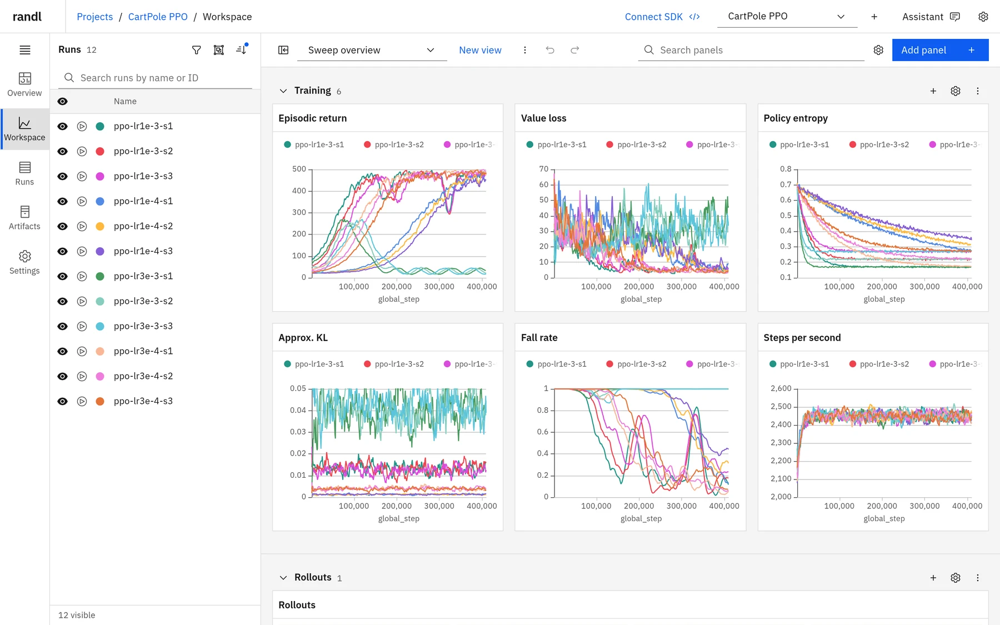

randl("rewards and losses")은 직접 운영하는 실험 추적 도구입니다. 환경 변수 두 개만
설정하면 기본 `wandb` 패키지가 randl에 기록하고, 빠른 웹 대시보드가 메트릭, 미디어,
아티팩트를 들어오는 대로 보여 줍니다. 같은 워크스페이스를 `randl` 명령줄로도, 여러분이
선택한 모델 제공업체에서 동작하는 AI 어시스턴트로도 다룰 수 있습니다. 모든 데이터는
여러분의 컴퓨터나 서버에 남습니다. Node.js 프로세스 하나, SQLite 데이터베이스 하나, 파일
폴더 하나로 구성됩니다.

## randl을 쓰는 이유

- **W&B SDK를 그대로 대체합니다.** `WANDB_BASE_URL`을 randl로 지정하면 학습 코드는
  그대로 쓸 수 있습니다. 메트릭, 구성, 요약, 이미지, 동영상, 오디오, 테이블,
  히스토그램, 파일, 아티팩트, 재개, 오프라인 동기화, 중지 요청이 실제 SDK에서
  동작합니다.
- **데이터는 여러분의 것입니다.** 계정도 클라우드 서비스도 필요 없습니다. 기본적으로
  `127.0.0.1`에서 수신하며, API 키와 HTTPS 리버스 프록시를 사용하면 어디서든 접속할
  수 있습니다.
- **완전한 대시보드.** 저장된 뷰가 있는 워크스페이스, 그룹화, 스무딩, 계산 메트릭,
  미디어 패널, 실행 테이블, 아티팩트, 프로젝트 개요를 제공합니다. 인터페이스는 7개
  언어로 제공됩니다.
- **워크스페이스를 대신 구성해 주는 어시스턴트.** "가장 좋은 실행 세 개를 비교해 줘"나
  "학습률별로 그룹화한 가치 손실 패널을 추가해 줘"처럼 평소 말투로 요청하면, 실행을
  읽고 대시보드 및 CLI와 같은 도구로 뷰, 패널, 실행 선택을 만듭니다. 모델 제공업체는
  Anthropic, OpenAI, Google, OpenRouter 등 여러 곳 중에서 직접 고를 수 있습니다.
  여러분이 확인하지 않으면 프로젝트를 삭제할 수 없습니다.
- **명령줄에서 스크립트로 다룰 수 있습니다.** `randl` CLI는 로컬 또는 원격 서버의
  프로젝트, 실행, 뷰, 패널, 실행 선택, 아티팩트, 플러그인을 관리하며, `jq`, 스크립트,
  CI에서 쓸 수 있도록 JSON을 출력합니다. `randl tools`는 모든 도구를 JSON Schema로
  설명하므로 Claude Code나 Codex 같은 코딩 에이전트도 randl을 조작할 수 있습니다.
- **긴 실행, 많은 실행에서도 빠릅니다.** 차트는 화면에 스크롤되어 들어올 때 불러오고,
  그래프의 픽셀 수와 비슷한 개수의 포인트를 가져오며(구간마다 최솟값과 최댓값을
  가져오므로 튀는 값도 그대로 보입니다), 확대하거나 크게 보면 더 정밀해집니다.
- **저장 공간을 적게 씁니다.** 히스토리는 압축 블록에 손실 없이 저장됩니다. 자체 합성
  벤치마크에서 인덱스를 포함한 전체 데이터베이스는 담고 있는 JSON 히스토리의 약
  5분의 1 크기였습니다.

## 빠른 시작

[Node.js](https://nodejs.org/) 22.19 이상이 필요합니다. Python은 학습 코드에만
필요합니다.

**1. randl 설치 및 시작.** 이 저장소를 클론한 위치에서 실행합니다.

```sh
npm ci
npm run build
npm start
```

서버는 [http://127.0.0.1:8742](http://127.0.0.1:8742)에서 수신하며 데이터를 `.data/`에
저장합니다. 둘 중 하나를 바꾸려면 `npm start -- --port 9000 --data-dir /path/to/data`를
사용합니다.

**2. W&B SDK가 randl을 가리키도록 설정.** 학습 코드를 실행하는 셸에서 다음을
실행합니다.

```sh
pip install wandb numpy pillow moviepy
export WANDB_BASE_URL=http://127.0.0.1:8742
export WANDB_API_KEY=0000000000000000000000000000000000000000
```

이 자리표시자 키는 API 키가 구성되지 않은 로컬 서버에서 동작합니다. `moviepy`는
NumPy 배열에서 동영상을 기록할 때만 필요합니다.

**3. 평소처럼 실행을 기록합니다.**

```python
import numpy as np
import wandb

with wandb.init(project="quickstart", config={"lr": 3e-4, "batch_size": 64}) as run:
    for step in range(200):
        loss = 2.0 * np.exp(-step / 60) + 0.05 * np.random.rand()
        metrics = {"train/loss": loss, "train/accuracy": 1 - loss / 2.1}
        if step % 50 == 0:
            image = np.random.randint(0, 255, (64, 64, 3), dtype=np.uint8)
            metrics["samples"] = wandb.Image(image, caption=f"step {step}")
            frames = np.random.randint(0, 255, (16, 3, 64, 64), dtype=np.uint8)  # time, channel, H, W
            metrics["rollout"] = wandb.Video(frames, fps=8, format="mp4")
        run.log(metrics)
```

**4. [http://127.0.0.1:8742](http://127.0.0.1:8742)를 엽니다.** 실행은 `local`
엔티티의 **quickstart** 프로젝트 아래에 나타나며, 메트릭마다 차트가 하나씩, 이미지와
동영상에는 패널이 표시됩니다. 프로젝트 헤더의 **SDK 연결**을 누르면 프로젝트가 채워진
상태로 이 설정을 보여 줍니다.

다른 연결 방법:

- `wandb login --relogin --host http://127.0.0.1:8742 KEY`를 실행하면 환경 변수를
  사용하는 대신 randl을 사용자 계정의 기본 W&B 호스트로 저장합니다.
- `WANDB_MODE=offline`으로 기록한 실행은 변수를 설정한 뒤
  `wandb sync wandb/offline-run-*`로 업로드합니다.
- 엔티티 없이 시작한 실행은 서버의 기본 엔티티인 `local`을 사용합니다. W&B 사용자
  이름 등 다른 엔티티를 쓰려면 `--entity NAME`(또는 `RANDL_ENTITY=NAME`)으로 서버를
  시작합니다.

## 둘러보기

### 실행을 따라가는 워크스페이스

워크스페이스는 표시된 모든 실행을 패널 섹션으로 비교하며, 패널은 데이터가 들어오는
대로 실시간으로 업데이트됩니다. 실행 목록에서 클릭하거나 드래그해 실행을 표시, 숨기기,
**단독 표시**할 수 있고(여러 실행을 동시에 단독 표시할 수 있습니다), 최대 20개 실행을
맨 위에 고정하고, 실행마다 색상을 지정할 수 있습니다. 패널, 실행 선택, 색상, 필터,
차트 설정은 **뷰**에 저장되며 실행 취소와 다시 실행을 지원합니다.

- 선 그래프, 영역 그래프, 누적 영역 그래프, 백분율 영역 그래프, 막대 그래프, 산점도,
  히스토리 산점도, 평행 좌표, 히스토그램, 테이블, 이미지, 오디오, 비디오 패널.
- 마우스를 올리거나 키보드로 값을 살펴봅니다. 커서와 마우스를 올린 실행은 패널과 실행
  목록 사이에서 연동됩니다.
- 차트에서 드래그하면 확대되며, 없는 포인트만 가져옵니다.
- 네 가지 스무딩 방법(EMA, 시간 가중 EMA, 가우시안, 중심 이동 평균), 로그 축, 고정
  범위, **Y축 범위에서 이상값 제외**를 패널별, 섹션별 또는 워크스페이스 전체에
  설정할 수 있습니다.
- 패널을 PNG로, 데이터를 CSV로 내보낼 수 있습니다.

### 그룹화와 집계

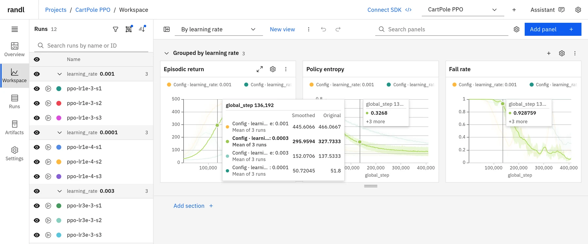

구성 값, 태그, 실행 필드 중 무엇으로든 차트를 그룹화해 각 그룹의 평균, 중앙값,
최솟값 또는 최댓값을 산포 밴드와 함께 그릴 수 있습니다. 마우스를 올리면 각 그룹의
이름과 평균에 포함된 실행 수가 표시됩니다. 실행 목록과 실행 테이블은 차트와 별개로
그룹화할 수 있습니다.

### 실행마다 차트 하나

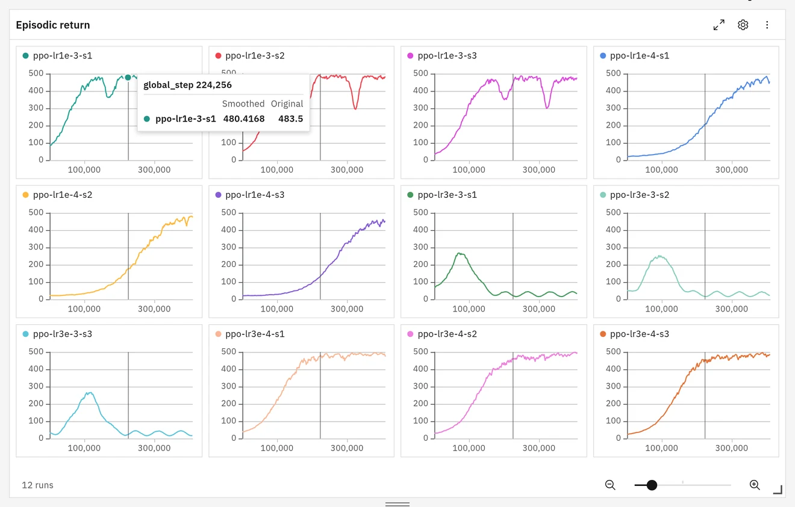

**레이아웃 → 그리드**는 각 실행이나 그룹을 축을 공유하는 작은 차트에 따로 그리고,
**커버플로**는 하나씩 보여 줍니다. 마우스 오버, 커서, 확대는 셀 사이에서 연동됩니다.

### 이미지, 동영상, 오디오

<table>
  <tr>
    <td width="50%">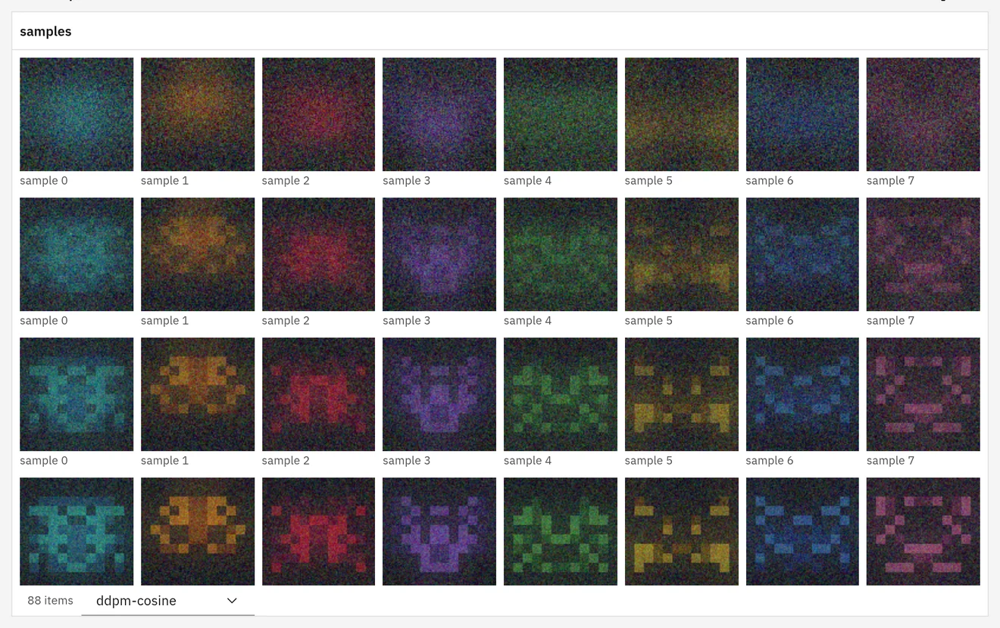</td>
    <td width="50%">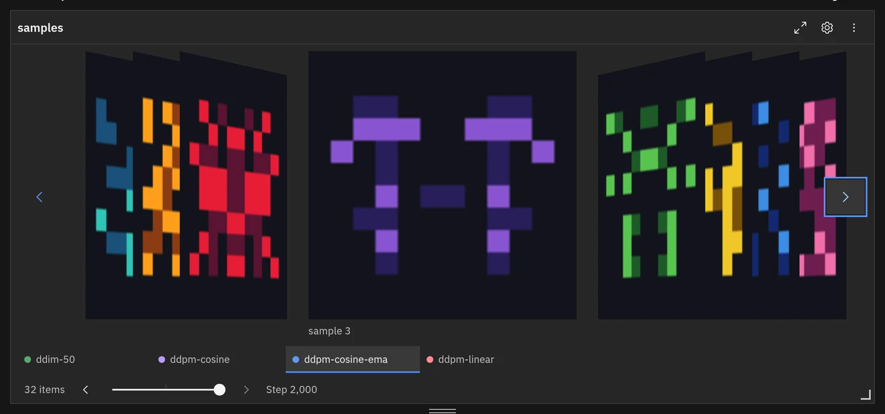</td>
  </tr>
</table>

미디어 패널은 기록된 모든 파일을 타일로 보여 줍니다. 한 스텝의 모든 실행을 보거나 한
실행의 여러 스텝을 볼 수 있으며, 스텝 슬라이더는 섹션 전체가 공유합니다. 이미지와
동영상 포스터는 화면에 보이는 타일만 불러옵니다. 동영상은 화면에 있는 동안 음소거
상태로 자동 재생되고 반복 재생되며(둘 다 끌 수 있습니다), 탐색이 가능한 스트리밍으로
재생됩니다. **커버플로**는 파일을 하나씩 보여 주며, 타일에서 Enter를 누르면 전체
화면으로 엽니다.

### 계산 메트릭

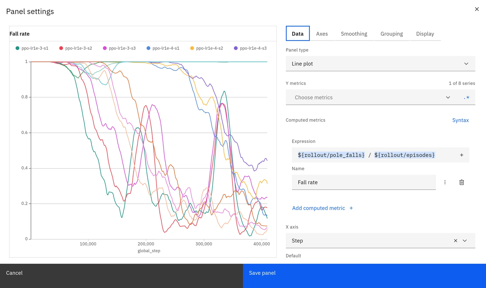

`${rollout/pole_falls} / ${rollout/episodes}` 같은 수식을 기록된 메트릭 옆에 그릴 수
있습니다. 수식은 그룹화와 스무딩 전에 히스토리 레코드마다 계산되며, 구문 강조와
메트릭 이름 및 `Math.` 함수 자동 완성을 지원합니다. randl이 수식을 직접 파싱하므로
JavaScript는 실행되지 않습니다.

### 실행 테이블

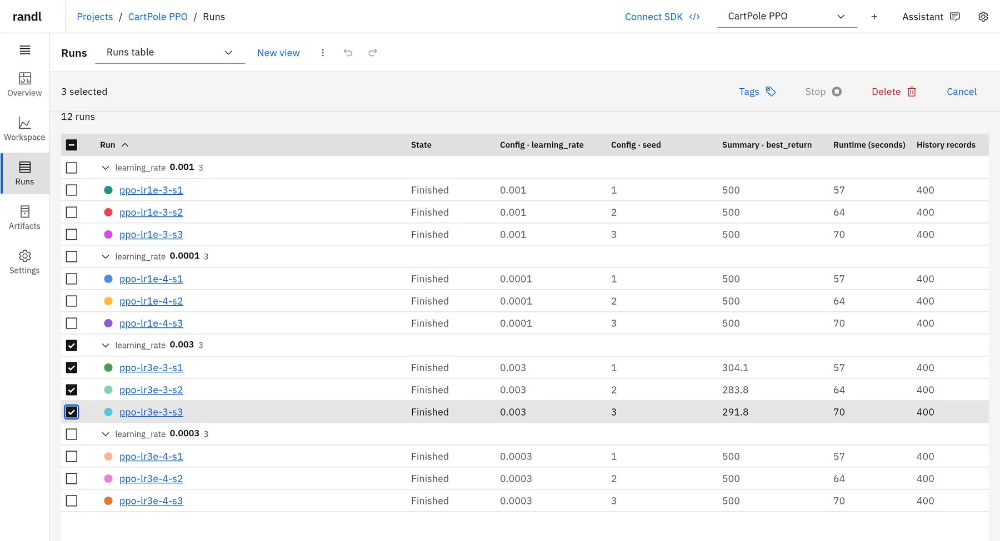

실행을 검색, 필터링, 정렬, 그룹화하고, 구성, 요약, 실행 필드에서 최대 32개 열을
선택하고, 실행을 선택해 태그를 지정하거나 중지하거나 삭제할 수 있습니다. 삭제된
실행은 프로젝트 설정에서 복원할 수 있습니다.

### 프로젝트 개요와 서버 상태

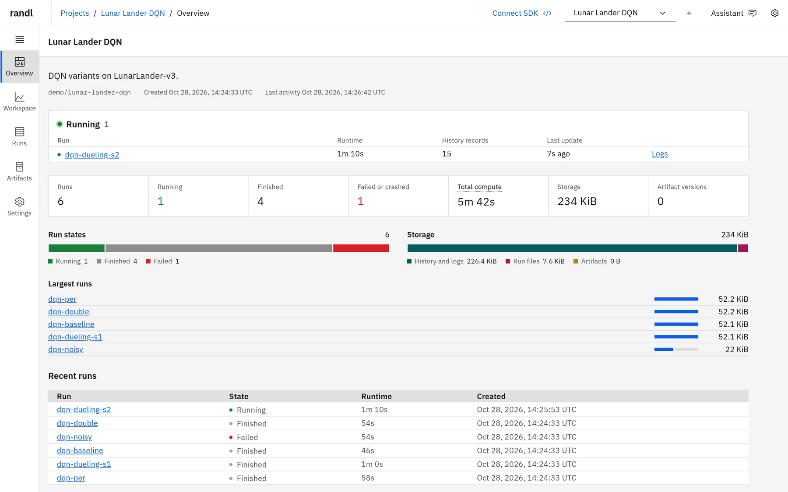

각 프로젝트의 개요는 실행 중인 실행을 실시간 실행 시간과 함께 나열하고, 상태별 실행
수를 세고, 컴퓨팅 시간과 스토리지 합계를 보여 주며, 가장 큰 실행과 최근 실행으로
연결합니다. **서버** 페이지는 지난 1시간의 요청, 응답 시간, 전송 바이트, 오류율과
함께 메모리 및 데이터베이스 크기를 차트로 보여 줍니다.

### 어시스턴트에게 물어보기

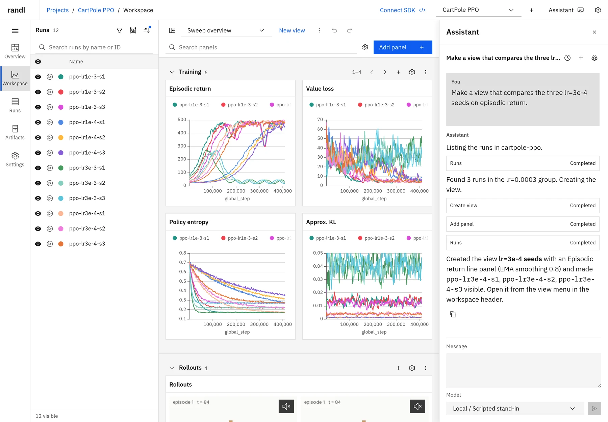

헤더에서 **어시스턴트**를 열고 보고 싶은 내용을 설명하세요. 어시스턴트는 지금 열려 있는
프로젝트와 뷰를 알고 있으며, 실행, 메트릭, 저장된 뷰를 찾아본 뒤 직접 변경합니다. 예를
들면 다음과 같습니다.

- "에피소드 반환값 기준으로 가장 좋은 실행 세 개를 비교해 줘." 실행의 요약을 읽고,
  에피소드 반환값 차트가 있는 뷰를 만든 다음 세 실행을 단독 표시합니다.
- "학습률별로 그룹화한 가치 손실 패널을 추가해 줘." 열려 있는 뷰에 `learning_rate` 구성
  값으로 그룹화한 선 그래프를 추가합니다.
- "비정상 종료된 실행에 unstable 태그를 붙이고 숨겨 줘." 실행에 태그를 지정하고 뷰의 실행
  선택을 업데이트합니다.

각 도구 호출은 실행되는 대로 대화에 표시되며, 결과는 직접 계속 편집할 수 있는 일반적인
저장된 뷰입니다. 대화는 **대화 기록**에 보관됩니다. 어시스턴트가 삭제한 실행은 프로젝트
설정에서 복원할 수 있습니다. 확인이 필요한 작업은 프로젝트 삭제뿐입니다. 대화
안의 카드가 여러분이 프로젝트 이름을 입력할 때까지 기다리며, 모델이 대신 확인할 수
없습니다.

어시스턴트는 Pi 코딩 에이전트를 기반으로 하며, 셸이나 파일 접근 없이 randl의 관리 도구만
불러옵니다. 제공업체와 모델은 **앱 설정 → 어시스턴트**에서 선택합니다. Anthropic, OpenAI,
Google, Mistral, OpenRouter 또는 Pi가 지원하는 다른 제공업체의 API 키를 저장하거나, 서버에서
Pi로 로그인하거나, Pi의 `models.json`에 자체 엔드포인트를 추가할 수 있습니다. 프롬프트와
도구 결과는 모델의 제공업체로 전송됩니다.

### randl CLI로 스크립트 작성하기

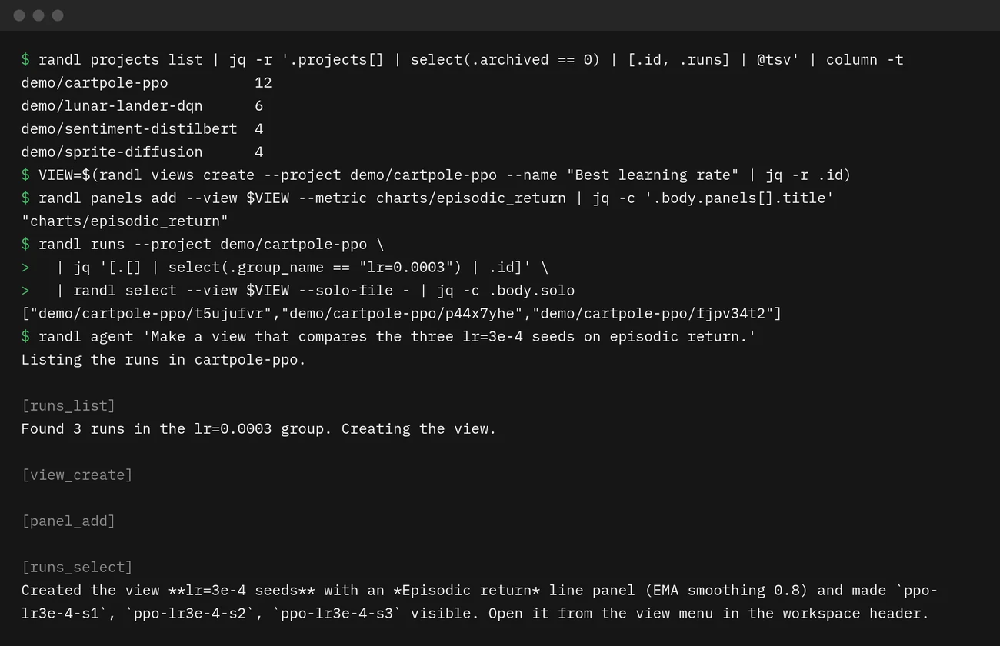

어시스턴트가 할 수 있는 모든 작업은 `randl` 명령으로도 할 수 있으며, 아티팩트, 플러그인,
프로젝트 관리도 명령으로 제공됩니다. 명령은 JSON을 출력하므로 `jq`, 셸 스크립트, CI 작업과
함께 쓸 수 있고, 원격 서버에서도 똑같이 동작합니다. 다음 세션은 뷰를 직접 만듭니다.

```sh
alias randl="node $PWD/backend/dist/cli.js"  # once, from the repository root

VIEW=$(randl views create --project demo/cartpole-ppo --name "Best learning rate" | jq -r .id)
randl panels add --view $VIEW --metric charts/episodic_return
randl runs --project demo/cartpole-ppo \
  | jq '[.[] | select(.group_name == "lr=0.0003") | .id]' \
  | randl select --view $VIEW --solo-file -
```

`randl tools`는 모든 관리 도구를 인수의 JSON Schema와 함께 나열하고,
`randl tool NAME --json ARGUMENTS`는 짧은 명령에서 빠진 옵션을 포함해 어떤 도구든
호출합니다.

```sh
randl tools | jq -r '.tools[].name'
randl tool panel_add --json '{"view": "'$VIEW'", "plugin": "line", "metric": "losses/value_loss", "settings": {"groupBy": "config.learning_rate"}}'
```

`randl agent`는 어시스턴트에 요청 하나를 보내고 응답을 출력하며, 각 도구 호출은 표준
오류로 출력합니다. `--confirm-delete-project entity/project`로 허용하지 않는 한 프로젝트
삭제는 거절합니다.

```sh
randl agent 'Compare my three best runs on episodic return'
```

**코딩 에이전트와 함께.** 명령은 입력을 요청하지 않고, JSON을 출력하며, 오류는 0이 아닌
종료 상태와 함께 표준 오류로 보고하므로 Claude Code나 Codex 같은 코딩 에이전트가 randl을
바로 사용할 수 있습니다. 에이전트에게 `randl --help`와 `randl tools`를 읽게 한 다음, 예를
들어 방금 시작한 실험에 맞는 뷰를 설정해 달라고 요청하세요.

스크린샷은 로컬 대체 모델을 사용했으며, 도구 호출은 실제 서버에 대해 실행되었습니다.

### 어떤 화면에서든, 여러분의 언어로

<table>
  <tr>
    <td width="34%">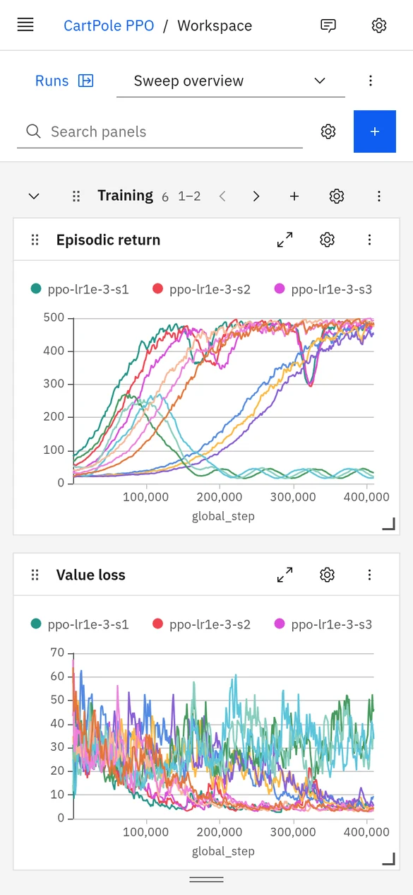</td>
    <td>
      레이아웃은 휴대폰 화면에 맞게 조정되며, 차트는 터치로 조작할 수 있습니다. 길게
      누른 다음 드래그하면 확대됩니다.<br><br>
      라이트 테마와 다크 테마는 시스템 설정이나 사용자의 선택을 따르며, 여러 강조 색상
      중에서 고를 수 있습니다. 실행 색상은 두 테마 모두에서 W&amp;B의 팔레트를
      사용합니다.<br><br>
      인터페이스는 영어, 중국어 간체, 중국어 번체(대만), 일본어, 한국어, 프랑스어,
      스페인어로 제공됩니다. 실행 이름, 메트릭 키 및 기타 기록된 데이터는 항상 기록된
      그대로 표시됩니다.
    </td>
  </tr>
</table>

## W&B 호환성

randl은 Python SDK가 추적에 사용하는 W&B 프로토콜의 해당 부분을 구현합니다. 실제
`wandb` **0.30.0** 패키지로, API 키가 있는 경우와 없는 경우 모두 테스트되었습니다.

| 지원 기능                                                        | 비고                                                         |
| ---------------------------------------------------------------- | ------------------------------------------------------------ |
| `wandb.init`, `run.log`, 구성, 요약, 태그, 그룹, 메모            |                                                              |
| 이미지, 동영상, 오디오, 테이블, 히스토그램                       | 미디어, 테이블, 히스토그램 패널에 표시                       |
| `define_metric` 스텝 메트릭과 숨김 메트릭                        | 요약 집계는 SDK가 계산                                       |
| 완료, 실패, 재개(`resume="allow"` / `"must"`), 대시보드에서 중지 | 10분 동안 연결이 없는 실행은 비정상 종료로 표시              |
| 실행 파일, 환경 메타데이터, 시스템 메트릭, 콘솔 로그             |                                                              |
| 아티팩트: 기록, 버전 관리, 별칭, 사용, 다운로드                  | 파일당 최대 10 GiB                                           |
| `wandb login --host`, `WANDB_MODE=offline`과 `wandb sync`        |                                                              |
| `run.alert()`                                                    | 실행 페이지에 표시. 이메일이나 채팅 알림은 없음              |
| `wandb.Api()`로 실행 읽기                                        | 필터 없는 `Api().run(...)` 및 `Api().runs("entity/project")` |

지원하지 않는 기능: Reports, Sweeps, Registry, Launch, Weave, Vega 또는 Plotly 사용자
지정 차트, W&B 계정과 팀(randl은 소유자가 한 명입니다), 외부 아티팩트 참조와 멀티파트
아티팩트 업로드, 실행 읽기 외의 공개 API 호출. 지원하지 않는 요청은 데이터를 저장한
척하지 않고 오류를 반환합니다.

## 셀프 호스팅

자신의 워크스테이션에서는 `npm start`만으로 충분합니다. 다른 컴퓨터에서 randl을
사용하려면 소유자 API 키를 지정하고 HTTPS 리버스 프록시 뒤에 배치합니다.

```sh
export RANDL_API_KEY="$(openssl rand -hex 32)"
export RANDL_PUBLIC_URL=https://randl.example.com
npm start -- --host 127.0.0.1 --data-dir /srv/randl
```

브라우저는 이 키로 로그인합니다. 클라이언트 컴퓨터에서는 같은 키를 `RANDL_API_KEY`로
내보냅니다. CLI는 `RANDL_URL`과 `RANDL_API_KEY`를 읽으며, SDK도 같은 값을 사용합니다.

```sh
export RANDL_URL=https://randl.example.com
export WANDB_BASE_URL="$RANDL_URL"
export WANDB_API_KEY="$RANDL_API_KEY"
```

[DEPLOYMENT.md](DEPLOYMENT.md)(영어)에서는 [deploy/Caddyfile](deploy/Caddyfile)의
Caddy 예제, 백업, 업로드 한도, 어시스턴트 제공업체 설정을 다룹니다.

| `randl serve` 옵션 | 기본값          | 용도                                                                 |
| ------------------ | --------------- | -------------------------------------------------------------------- |
| `--port`           | `8742`          | 수신 포트                                                            |
| `--host`           | `127.0.0.1`     | 수신 주소                                                            |
| `--data-dir`       | `.data`         | 데이터베이스, 업로드된 파일, 설치된 플러그인                         |
| `--public-url`     |                 | 공개 HTTPS 주소(또는 `RANDL_PUBLIC_URL`)                             |
| `--entity`         | `local`         | 엔티티를 지정하지 않은 실행의 엔티티(또는 `RANDL_ENTITY`)            |
| `--run-timeout`    | `600`           | 실행 중인 실행을 비정상 종료로 처리하기까지 SDK 연결이 없는 시간(초) |
| `--frontend-dir`   | `frontend/dist` | 배포된 빌드 인터페이스 사본을 제공                                   |
| `--pi-agent-dir`   | `<data-dir>/pi` | 어시스턴트 프로필 디렉터리(또는 `RANDL_PI_AGENT_DIR`)                |

`ffmpeg`가 설치되어 있으면 randl은 이를 사용해 동영상 포스터를 만듭니다.
`RANDL_FFMPEG`에 경로를 지정하거나 `off`로 설정할 수 있습니다.

## 명령줄

예제는 둘러보기에서 설정한 `randl` 별칭을 사용합니다. 스크립트에서는 대신
`node /path/to/randl/backend/dist/cli.js`를 호출하세요. 모든 명령은 JSON을 출력하고,
오류가 나면 0이 아닌 상태로 종료하며, `RANDL_URL`(기본값 `http://127.0.0.1:8742`)에
연결하고 서버에 키가 있으면 `RANDL_API_KEY`를 사용합니다. 전체 명령은 `randl --help`에서
확인할 수 있습니다.

```sh
randl status
randl projects list
randl projects create --id local/robotics --name Robotics
randl runs --project local/quickstart
randl runs show --id local/quickstart/RUN_ID
randl runs add-tags --ids local/quickstart/RUN_ID --tags baseline
randl views list
randl artifacts list
randl artifacts download --id ARTIFACT_ID --output ./downloads
randl projects delete --id local/robotics --confirm Robotics
```

## 패널 플러그인

내장이든 설치한 것이든 모든 패널은 같은 플러그인 인터페이스를 사용합니다. 즉
`panel.json` 매니페스트와, 데이터를 받아 렌더링하는 브라우저 모듈로 구성됩니다.
플러그인은 패널 편집기에 타입이 지정된 옵션을 추가하고 자체 번역을 포함할 수
있습니다. 로컬 디렉터리나 GitHub 저장소에서 설치합니다.

```sh
randl plugins install --source ./examples/plugins/stat-card
randl plugins enable --id stat-card
```

설치된 플러그인은 비활성화된 상태로 시작합니다. 활성화하면 대시보드 안에서 대시보드
데이터에 접근할 수 있는 상태로 실행되므로, 신뢰할 수 있는 코드만 설치하세요. randl은
소스를 복사할 뿐 설치 또는 빌드 스크립트를 실행하지 않습니다. 직접 작성하려면
[PLUGINS.md](PLUGINS.md)(영어)를 참고하세요.

## 상태

randl은 아직 초기 단계이며 빠르게 변하고 있습니다. 버전 간에 호환성이 깨지는 변경이
있을 수 있습니다. randl은 독립적인 구현으로, Weights & Biases와 제휴하지 않았습니다.
W&B 서버와 대시보드는 randl에 포함되어 있지 않습니다. [CONTRIBUTING.md](CONTRIBUTING.md)(영어)에서
개발 환경 설정, 테스트, 아키텍처를 설명합니다.

## 라이선스

randl은 [MIT 라이선스](LICENSE)로 배포됩니다.
