<p align="center">
  
</p>

<h1 align="center">randl</h1>

<p align="center">
  <b>Self-hosted experiment tracking for the W&amp;B Python SDK.</b><br>
  Keep your <code>wandb.init()</code> and <code>wandb.log()</code> code; send the runs to your own server.<br>
  Explore them in the dashboard, script them with the <code>randl</code> CLI, or ask the built-in Assistant.
</p>

<p align="center">
  <b>English</b> ·
  <a href="README.zh-Hans.md">简体中文</a> ·
  <a href="README.zh-Hant.md">繁體中文</a> ·
  <a href="README.ja.md">日本語</a> ·
  <a href="README.ko.md">한국어</a> ·
  <a href="README.fr.md">Français</a> ·
  <a href="README.es.md">Español</a>
</p>

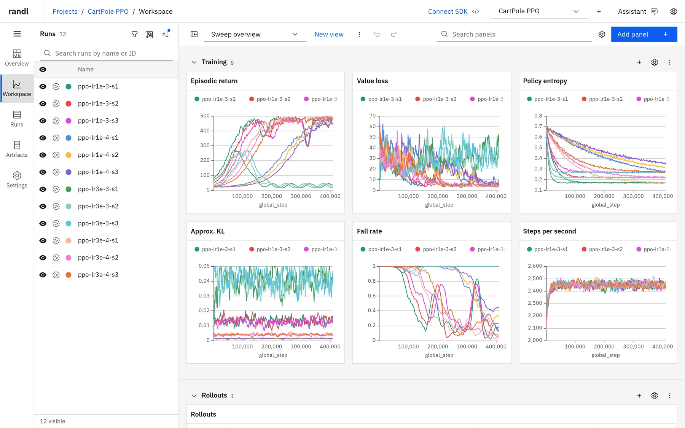

randl ("rewards and losses") is an experiment tracker you run yourself. The stock
`wandb` package logs to it when you set two environment variables, and a fast web
dashboard shows your metrics, media and artifacts as they arrive. The same workspace
answers to the `randl` command line and to an AI Assistant that runs on the model
provider you choose. Everything stays on your machine or your server: one Node.js
process, one SQLite database and a folder of files.

## Why randl

- **Drop-in for the W&B SDK.** Point `WANDB_BASE_URL` at randl and keep your training
  code. Metrics, config, summaries, images, video, audio, tables, histograms, files,
  artifacts, resuming, offline sync and stop requests work with the real SDK.
- **Yours to keep.** No account and no cloud service. It listens on `127.0.0.1` by
  default; with an API key and an HTTPS reverse proxy you can reach it from anywhere.
- **A complete dashboard.** Workspaces with saved views, grouping, smoothing, computed
  metrics, media panels, a runs table, artifacts and project overviews. The interface is
  available in seven languages.
- **An Assistant that sets up the workspace for you.** Ask in plain language, such as
  "compare my three best runs" or "add a panel for the value loss grouped by learning
  rate", and it reads your runs and builds the views, panels and run selections with the
  same tools as the dashboard and the CLI. Bring your own model provider: Anthropic,
  OpenAI, Google, OpenRouter and many more. It cannot delete a project without your
  confirmation.
- **Scriptable from the command line.** The `randl` CLI manages projects, runs, views,
  panels, run selections, artifacts and plugins on a local or remote server and prints
  JSON for `jq`, scripts and CI. `randl tools` describes every tool with a JSON Schema,
  so coding agents such as Claude Code or Codex can drive randl as well.
- **Fast with long runs and many runs.** Charts load as they scroll into view, fetch
  about as many points as the plot has pixels (minimum and maximum per bucket, so spikes
  stay visible), and refine when you zoom or enlarge them.
- **Lean storage.** History is kept losslessly in compressed blocks. In our synthetic
  benchmark the whole database, indexes included, took about a fifth of the space of
  the JSON history it holds.

## Quick start

You need [Node.js](https://nodejs.org/) 22.19 or newer. Python is needed only for your
training code.

**1. Install and start randl.** From a clone of this repository:

```sh
npm ci
npm run build
npm start
```

The server listens on [http://127.0.0.1:8742](http://127.0.0.1:8742) and keeps its data
in `.data/`. Use `npm start -- --port 9000 --data-dir /path/to/data` to change either.

**2. Point the W&B SDK at it.** In the shell that runs your training code:

```sh
pip install wandb numpy pillow moviepy
export WANDB_BASE_URL=http://127.0.0.1:8742
export WANDB_API_KEY=0000000000000000000000000000000000000000
```

The placeholder key works with a local server that has no API key configured.
`moviepy` is needed only to log videos from NumPy arrays.

**3. Log a run** the way you already do:

```python
import numpy as np
import wandb

with wandb.init(project="quickstart", config={"lr": 3e-4, "batch_size": 64}) as run:
    for step in range(200):
        loss = 2.0 * np.exp(-step / 60) + 0.05 * np.random.rand()
        metrics = {"train/loss": loss, "train/accuracy": 1 - loss / 2.1}
        if step % 50 == 0:
            image = np.random.randint(0, 255, (64, 64, 3), dtype=np.uint8)
            metrics["samples"] = wandb.Image(image, caption=f"step {step}")
            frames = np.random.randint(0, 255, (16, 3, 64, 64), dtype=np.uint8)  # time, channel, H, W
            metrics["rollout"] = wandb.Video(frames, fps=8, format="mp4")
        run.log(metrics)
```

**4. Open [http://127.0.0.1:8742](http://127.0.0.1:8742).** The run appears under the
`local` entity in the **quickstart** project, with a chart for each metric and panels
for the images and the video. **Connect SDK** on the project's **Settings** page shows these
settings with the project filled in.

Other ways to connect:

- `wandb login --relogin --host http://127.0.0.1:8742 KEY` saves randl as the default
  W&B host for your user account instead of using environment variables.
- Runs recorded with `WANDB_MODE=offline` upload with `wandb sync wandb/offline-run-*`
  once the variables are set.
- A run started without an entity uses the server's default entity, `local`. Start the
  server with `--entity NAME` (or `RANDL_ENTITY=NAME`) to use another one, such as your
  W&B username.

## A tour

### Workspaces that keep up with your runs

The workspace compares every visible run in sections of panels that update live as data
arrives. Show, hide or **solo** runs with a click or a drag across the run list (several
runs can be soloed at once), pin up to 20 runs to the top, and give runs their own
colors. Panels, run selections, colors, filters and chart settings are saved in
**views**, with undo and redo.

- Line, area, stacked area, percent area, bar, scatter, history scatter, parallel
  coordinates, histogram, table, image, audio and video panels.
- Hover or use the keyboard to inspect values; the cursor and the hovered run are
  linked across panels and the run list.
- Drag across a chart to zoom; only the missing points are fetched.
- Four smoothing methods (EMA, time-weighted EMA, Gaussian and centered running average), log
  axes, fixed ranges and **Exclude outliers from the Y range**, set per panel, per
  section or for the whole workspace.
- Export a panel as PNG or its data as CSV.

### Grouping and aggregation

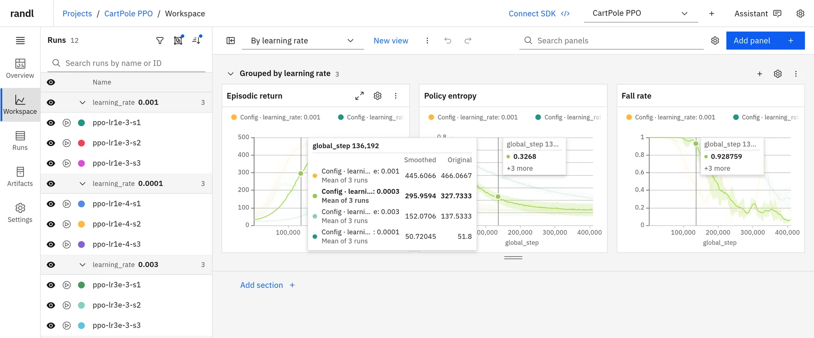

Group charts by any config value, tag or run field to plot the mean, median, minimum or
maximum of each group with a spread band. Hovering names each group and how many runs it
averages. The run list and runs table can be grouped independently of the charts.

### One chart per run

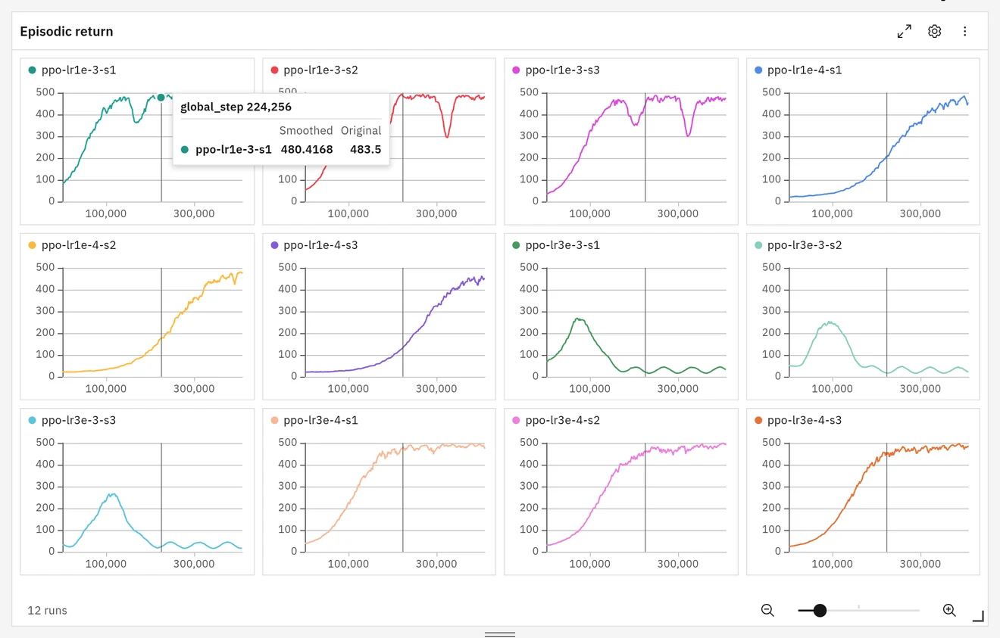

**Layout → Grid** draws each run or group in its own small chart with shared axes, and
**Coverflow** shows them one at a time. Hover, cursors and zoom stay linked across the
cells.

### Images, video and audio

<table>
  <tr>
    <td width="50%">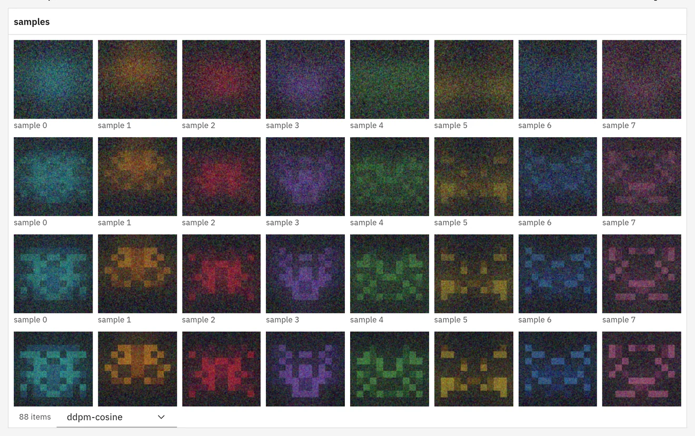</td>
    <td width="50%">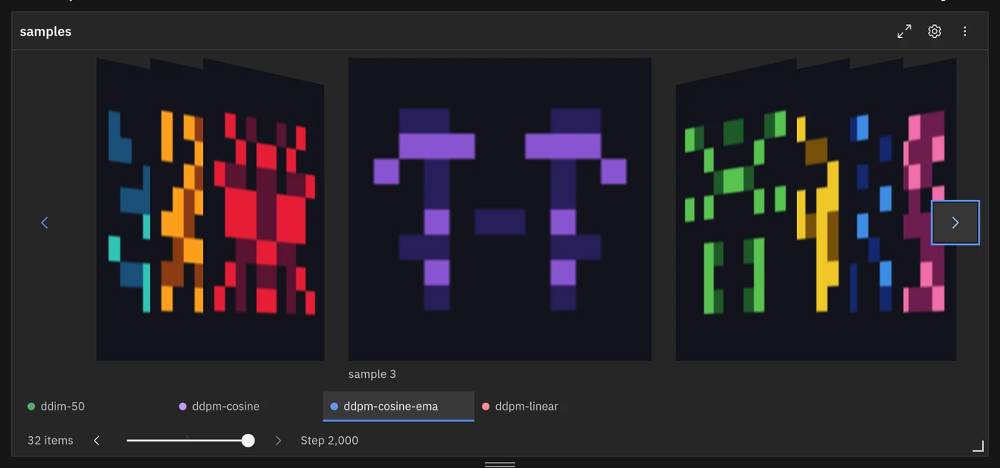</td>
  </tr>
</table>

Media panels show every logged file as a tile, either for all runs at one step or for
one run across its steps, with a slider shared by the section that steps through the
logged media by step, time or any metric, such as the epoch. Images and video
posters load only for tiles in view. Videos autoplay muted and loop while on screen
(both can be turned off) and stream with seeking. **Coverflow** presents the files one
at a time, and Enter on a tile opens it full screen.

### Computed metrics

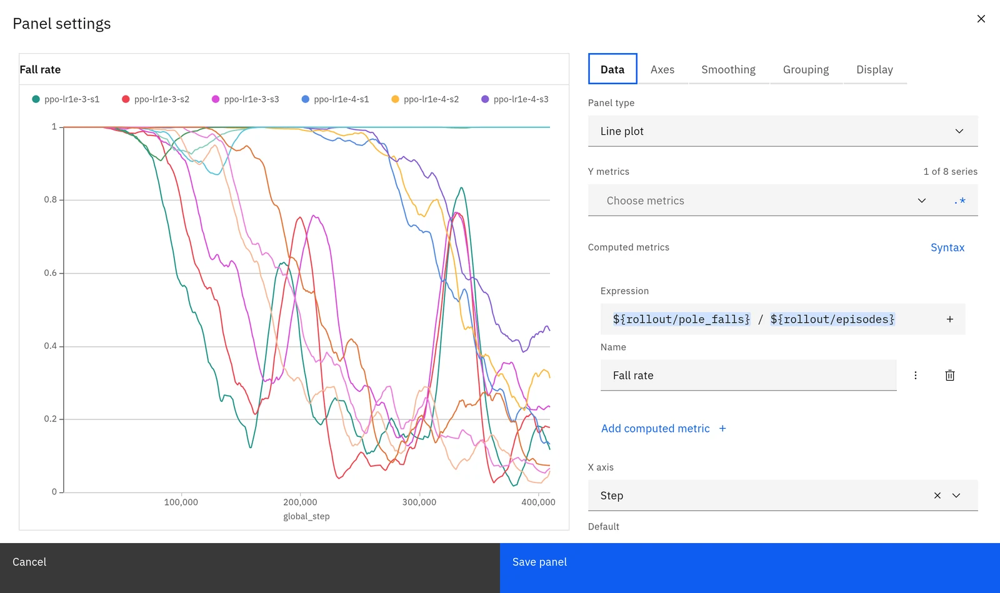

Plot a formula such as `${rollout/pole_falls} / ${rollout/episodes}` next to logged
metrics. Formulas are evaluated per history record before grouping and smoothing, with
syntax highlighting and completion of metric names and `Math.` functions. randl parses
them itself; no JavaScript is executed.

### Runs table

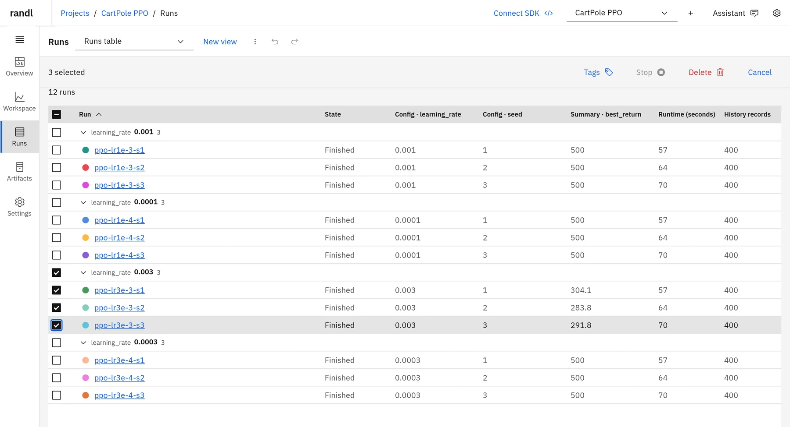

Search, filter, sort and group runs, choose up to 32 columns from config, summary and
run fields, and select runs to tag, stop or delete them. Deleted runs can be restored
from project settings.

### Run lineage

The **Lineage** page draws a project's runs as cards linked from the run each one started
from, so you can follow warm starts, extensions and grown architectures across hundreds of
experiments. A resumed or extended run stays one card. Each card shows the run's colour (the
same as in workspace charts) or its host's, its state, a verdict from its `verdict:adopted`,
`verdict:rejected` or `verdict:running` tag, the host and GPUs it last trained on, and the
latest and best value of the project's lineage metric. Running runs have an accent ring that
ripples (it holds still when the system asks for reduced motion). Each link is labelled with the
parent update and the run's logged `change` sentence, or, without one, any further relations
such as `+grown head` and the changed config keys that set the run apart (those that change on
the fewest links come first); hovering shows the whole label, and a legend explains the line
styles. Select a card for what changed, its hypothesis, result and verdict, relations, config
bases, compute segments, the metric along its lineage, and every config difference from its
parent or from another run you pick.

The controls sit in the page header on wide screens (a single row below it on narrow ones): the name filter; **Filters** (group, tag, host, collapse rejected
branches, show runs without lineage; the button counts the active ones); **View** (arrange cards
by lineage depth, start update or start time, and colour them by run or host); the actions for
the open or selected runs, as icons; and on the right an **i** button with the counts, zoom,
**Fit all**, **Focus running runs** and **Lineage settings**.

The page opens at 100% on the running runs (all of them when they fit, else the one that
reported last). Two-finger touchpad scrolling or the mouse wheel pans; pinching (or Ctrl+wheel)
zooms around the pointer; on touch screens, one finger pans and two pinch. **Fit all** and
**Focus running runs** are in the toolbar. The arrangement, colouring and the two checkboxes are
remembered per project in this browser.

To compare runs, Shift-click them, Shift-drag a box around them, or use **Select path from
root** or **Select branch** for the open run, then **Compare** (it shows how many): the project's
workspace view shows exactly those runs as solos (which override visibility until you clear
them) in its existing panels. The open run and the selection are kept in the URL (`?run=`,
`?select=` with SDK run IDs), so a link reopens them. **Show in lineage** on a run page, or for
the selected rows of the Runs table, opens the page on those runs.

A run names its parent in a `lineage` config block:

```python
wandb.config.update({"lineage": {
    "parent": {"run_id": "jnsf11ul", "run_path": "chuanhu/AeroSeeker_Forest/jnsf11ul",
               "run_name": "v621_…", "update": 543000,
               "checkpoint": "/…/checkpoints/v621_…/update_00543000"},
    "relation": ["initialize_from", "grown_head"],  # link kind first: initialize_from,
        # resume or extend; then any of grown_head, grown_gru, added_inputs, added_frames,
        # extends_config
    "changes": {"model.command_head_dim": [512, 1024]},
    "extends": [{"kind": "run", "reference": "v621_…"}, {"kind": "file", "reference": "forest.yaml"}],
    "recipe": "latched_box40",
    "change": "Command head widened from 512 to 1024 units",
    "hypothesis": "A wider command head holds more boxes",
    "result": "Best 377/512 holds at u560k, +12 over the parent",
    "verdict": {"status": "adopted", "reason": "More holds at equal collisions"},
    "compute": {"host": "Sirius", "gpu_count": 2, "segments": [
        {"from_update": 543000, "to_update": None, "host": "Sirius", "gpu_count": 2,
         "gpu_ids": [0, 1], "gpu_model": "RTX 4090 48GB", "slot": "sirius_34"}]},
}})
```

The parent is found by `run_id` (the SDK run ID), then `run_path`, then `run_name` (the display
name), then its `checkpoint` path as below. A plain string `relation` is the link kind alone.
`changes` maps dotted config keys to `[old, new]` and names the keys on the link instead of a
computed diff; `change` is a sentence for people and labels the link instead of either. The
`verdict:*` tag sets a run's verdict; `verdict.status` is used only for runs without one, and
`verdict.reason` is shown with it. `extends` entries of kind `run` are drawn as weaker config-base links. The block
is authoritative: a run that logs it with no parent (`null`, a cold start) or with itself as
parent (an in-place resume or extension) gets no link. Runs without the block are linked
by the checkpoint path in their **parent checkpoint keys** (default
`rl.checkpoint.initialize_from`, then `rl.checkpoint.resume`): the path's folder or a
`<name>_u<update>` (or `<name>_update_<update>`) warm-source label is matched, from the end of
the path, against other runs' **run folder keys** (default `rl.checkpoint.save_dir` and
`rl.checkpoint.run_name`) and display names, ignoring the host-specific start of the path. The
update comes from an `update_<N>` folder or the label. A path that names the run's own folder
adds no link. When several runs share the name, the latest created before the child is linked
and marked as ambiguous. Changed keys are then computed from the two stored configs, leaving out
`lineage.*`, the parent and folder keys, and the **keys left out of diffs** (by default
`*save_dir`, `*run_name`, `*runs_root`, `*_path`, `*_dir`, `*.name`, `*.resume`). Set the
metric, a display scale (512 shows a success rate as successes out of 512 episodes), whether
higher or lower is better, and the keys under **Lineage settings** on the page, or with the
`project_lineage_settings_get` and `project_lineage_settings_update` tools. The graph comes
from the `project_lineage` tool and full diffs from `runs_config_diff`; the CLI and the
Assistant use the same tools.

#### Updating stored runs

`run_metadata_update` (`POST /api/tools/run_metadata_update`, or `randl runs update-meta`)
changes a stored run's config keys, tags or notes, for example to backfill `lineage` blocks
and verdict tags, without touching its state, history, summary, files, runtime or snapshot
status:

```sh
randl runs update-meta --id chuanhu/AeroSeeker_Forest/jnsf11ul \
  --config-file lineage.json --add-tags verdict:adopted --remove-tags verdict:running \
  --by backfill-script
```

`config` (`--config` or `--config-file`, `-` for standard input) replaces top-level keys,
stored in W&B's `{"value": …}` layout, and `null` removes one; `configMerge` (`--merge`)
deep-merges objects into top-level keys, where a `null` leaf removes that nested key. `tags`
replaces the tag list; `addTags` and `removeTags` edit it; `notes` replaces the notes. Keys
starting with `_` belong to the SDK and are refused. The audit log records each change with its
time, arguments and `by`. Repeating a request changes nothing, not even the run's revision.
A running run's SDK sends its whole config again with each config update, which replaces
keys set this way, so update runs after they finish. `summary` (`--summary`) sets top-level
summary keys the same way.

`run_metrics_rename` (`randl runs rename-metrics --id RUN --rename old=new[,old2=new2]`)
renames metric keys of a stored run, for example so older runs compare with newer ones: its
history records (rewritten in place, one stored block at a time), chart points, logged media,
metric list, summary and define_metric settings. A key already renamed is left alone. A target
key that exists is refused unless `merge` (`--combine`) is set, and a merge is refused while any
step or history record holds both keys; one refused rename refuses the whole request. Each
rename reports its status and how many history records and points hold the old key, and
`dryRun` (`--dry-run`) only reports. Each rename returns an undo ID for
`run_metrics_rename_undo` (`--undo ID`), which restores the records, points and summary as they
were.

`run_history_write` (`randl runs write-history --id RUN --rows-file rows.json`) writes numeric
values into a stored run's history, such as audit results computed after training, which the
SDK cannot log at earlier steps. A row names its record by a logged field,
`{"match": {"update": 473000}, "values": {"audit/…/value": 0.73}}`, where exactly one record
must match, or by step, `{"step": 545000, "values": {…}}`, which adds a record when none has
that `_step`. A different stored value is refused unless `replace` (`--replace`) is set, and
identical values change nothing. Every row reports a status (merged, added, unchanged, or
refused for no match, several matches or a conflict); `dryRun` (`--dry-run`) only reports, and
one refused row refuses the whole request. These three tools are not available to the Assistant, and all
of them are audited with their `by`.

### Project overview and server status

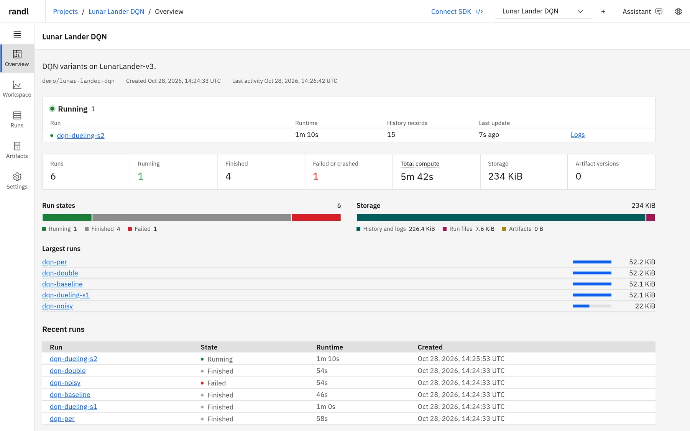

Each project's overview lists running runs with their live runtime, counts runs by
state, totals compute time and storage, and links to the largest and most recent runs.
The **Server** page charts requests, response times, transferred bytes and error rates
for the last hour, along with memory and database size.

### Ask the Assistant

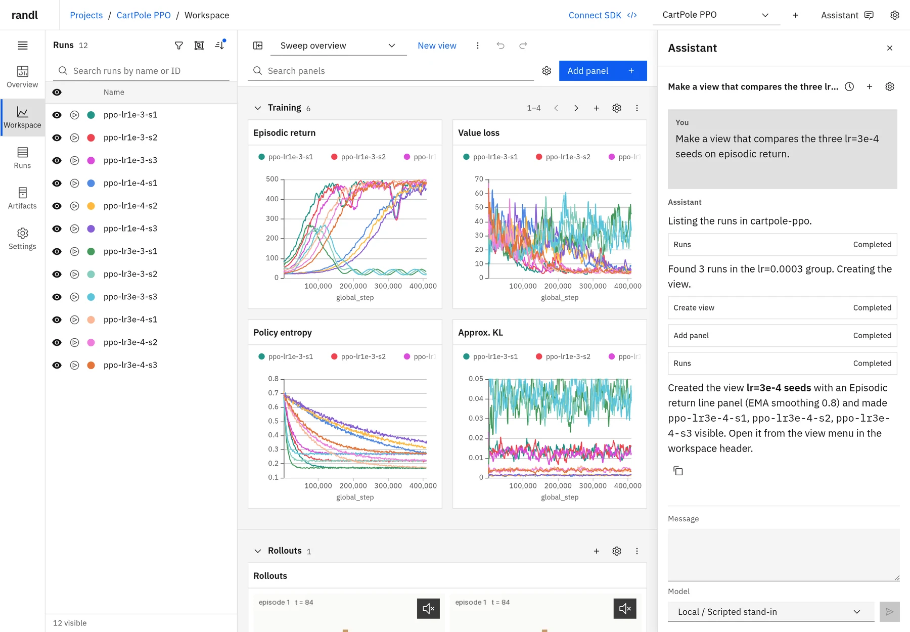

Open **Assistant** in the header and describe what you want to see. The Assistant knows
which project and view you have open, looks up runs, metrics and saved views, and makes
the change itself. For example:

- _"Compare my three best runs on episodic return."_ It reads the runs' summaries,
  creates a view with an episodic return chart and solos the three runs.
- _"Add a panel for the value loss grouped by learning rate."_ It adds a line chart to
  the open view, grouped by the `learning_rate` config value.
- _"Tag the crashed runs as unstable and hide them."_ It tags the runs and updates the
  view's run selection.

Each tool call is listed in the conversation as it runs, and the result is an ordinary
saved view that you can keep editing by hand. Conversations are kept in **Conversation
history**. Runs the Assistant deletes can be restored from project settings. Deleting a
project is the one action that needs your confirmation: a card in the conversation waits
for you to type the project's name, and the model cannot confirm it.

The Assistant is built on the Pi coding agent and loads only randl's management tools,
with no shell or file access; it cannot change server settings such as the media limit. Choose a provider and model in **App settings →
Assistant**: save an API key for Anthropic, OpenAI, Google, Mistral, OpenRouter or
another provider Pi supports, sign in with Pi on the server, or add your own endpoint to
Pi's `models.json`. Prompts and tool results are sent to the model's provider.

### Script it with the randl CLI

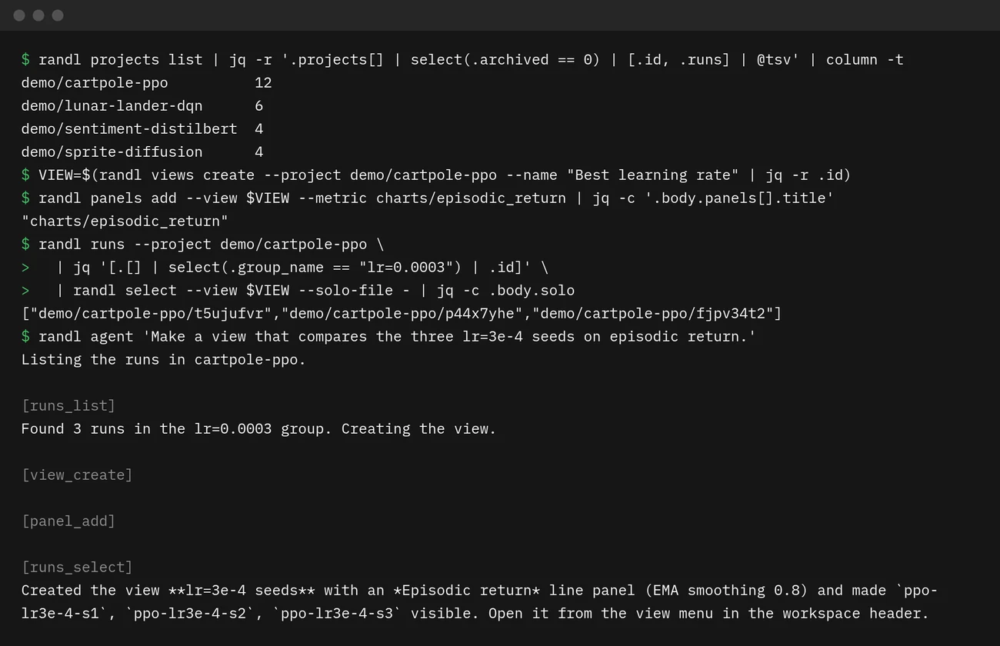

Everything the Assistant can do is also a `randl` command, along with artifacts, plugins
and project management. Commands print JSON, so they combine with `jq`, shell scripts
and CI jobs, and they work the same against a remote server. This session builds a view
by hand:

```sh
alias randl="node $PWD/backend/dist/cli.js"  # once, from the repository root

VIEW=$(randl views create --project demo/cartpole-ppo --name "Best learning rate" | jq -r .id)
randl panels add --view $VIEW --metric charts/episodic_return
randl runs --project demo/cartpole-ppo \
  | jq '[.[] | select(.group_name == "lr=0.0003") | .id]' \
  | randl select --view $VIEW --solo-file -
```

`randl tools` lists every management tool with a JSON Schema of its arguments, and
`randl tool NAME --json ARGUMENTS` calls any of them, including options the shorter
commands leave out:

```sh
randl tools | jq -r '.tools[].name'
randl tool panel_add --json '{"view": "'$VIEW'", "plugin": "line", "metric": "losses/value_loss", "settings": {"groupBy": "config.learning_rate"}}'
```

`randl agent` sends one request to the Assistant and prints its reply, with each tool
call on standard error. It declines project deletions unless you allow one with
`--confirm-delete-project entity/project`.

```sh
randl agent 'Compare my three best runs on episodic return'
```

**With coding agents.** Commands never prompt, print JSON and report errors on standard
error with a non-zero exit status, so coding agents such as Claude Code or Codex can use
randl directly. Tell the agent to read `randl --help` and `randl tools`, then ask it, for
example, to set up a view for the experiment it just launched.

The screenshots use a local stand-in model; the tool calls ran against a real server.

### On any screen, in your language

<table>
  <tr>
    <td width="34%">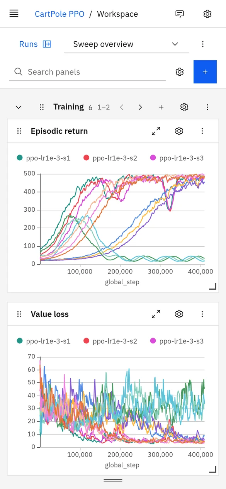</td>
    <td>
      The layout adapts to phone screens, and charts work by touch: press and hold, then
      drag to zoom.<br><br>
      Light and dark themes follow your system or your choice, with a selection of
      accent colors. Run colors use W&amp;B's palette in both themes.<br><br>
      The interface is available in English, Simplified Chinese, Traditional Chinese
      (Taiwan), Japanese, Korean, French and Spanish. Run names, metric keys and other
      logged data are always shown as logged.
    </td>
  </tr>
</table>

## W&B compatibility

randl implements the parts of the W&B protocol the Python SDK uses for tracking. It is
tested with the real `wandb` **0.30.0** package, with and without an API key.

| Works                                                                             | Notes                                                               |
| --------------------------------------------------------------------------------- | ------------------------------------------------------------------- |
| `wandb.init`, `run.log`, config, summary, tags, groups, notes                     |                                                                     |
| Images, video, audio, tables and histograms                                       | Shown in media, table and histogram panels                          |
| `define_metric` step metrics and hidden metrics                                   | Summary aggregation is computed by the SDK                          |
| Finish, failure, resume (`resume="allow"` / `"must"`) and stop from the dashboard | Runs without contact for 10 minutes are marked crashed              |
| Run files, environment metadata, system metrics and console logs                  |                                                                     |
| Artifacts: log, version, alias, use and download                                  | Files up to 10 GiB each                                             |
| `wandb login --host`, `WANDB_MODE=offline` with `wandb sync`                      |                                                                     |
| `run.alert()`                                                                     | Shown on the run page; no email or chat notifications               |
| `wandb.Api()` reading runs                                                        | `Api().run(...)` and `Api().runs("entity/project")` without filters |

Not supported: Reports, Sweeps, Registry, Launch, Weave, Vega or Plotly custom charts,
W&B accounts and teams (randl has a single owner), external artifact references and
multipart artifact uploads, and public API calls beyond reading runs. Unsupported
requests return errors rather than pretending to store data.

## Self-hosting

On your own workstation, `npm start` is all you need. To use randl from other machines,
give it an owner API key and put it behind an HTTPS reverse proxy:

```sh
export RANDL_API_KEY="$(openssl rand -hex 32)"
export RANDL_PUBLIC_URL=https://randl.example.com
npm start -- --host 127.0.0.1 --data-dir /srv/randl
```

The browser signs in with the key. On client machines, export the same key as
`RANDL_API_KEY`; the CLI reads `RANDL_URL` and `RANDL_API_KEY`, and the SDK takes the
same values:

```sh
export RANDL_URL=https://randl.example.com
export WANDB_BASE_URL="$RANDL_URL"
export WANDB_API_KEY="$RANDL_API_KEY"
```

[DEPLOYMENT.md](DEPLOYMENT.md) covers the Caddy example in [deploy/Caddyfile](deploy/Caddyfile),
backups, upload limits and Assistant provider setup.

| `randl serve` option | Default         | Purpose                                                     |
| -------------------- | --------------- | ----------------------------------------------------------- |
| `--port`             | `8742`          | Listening port                                              |
| `--host`             | `127.0.0.1`     | Listening address                                           |
| `--data-dir`         | `.data`         | Database, uploaded files and installed plugins              |
| `--public-url`       |                 | Public HTTPS address (or `RANDL_PUBLIC_URL`)                |
| `--entity`           | `local`         | Entity for runs that name none (or `RANDL_ENTITY`)          |
| `--run-timeout`      | `600`           | Seconds without SDK contact before a running run is crashed |
| `--frontend-dir`     | `frontend/dist` | Serve a deployed copy of the built interface                |
| `--pi-agent-dir`     | `<data-dir>/pi` | Assistant profile directory (or `RANDL_PI_AGENT_DIR`)       |

If `ffmpeg` is installed, randl uses it to make video posters; set `RANDL_FFMPEG` to its
path, or to `off`.

## Command line

The examples use the `randl` alias from the tour; in scripts, call
`node /path/to/randl/backend/dist/cli.js` instead. Every command prints JSON, exits with
a non-zero status on errors, and talks to `RANDL_URL` (default `http://127.0.0.1:8742`)
with `RANDL_API_KEY` when the server has one. `randl --help` lists all of them.

```sh
randl status
randl projects list
randl projects create --id local/robotics --name Robotics
randl runs --project local/quickstart
randl runs show --id local/quickstart/RUN_ID
randl runs add-tags --ids local/quickstart/RUN_ID --tags baseline
randl runs update-meta --id local/quickstart/RUN_ID --merge '{"lineage": {"hypothesis": "…"}}'
randl views list
randl artifacts list
randl artifacts download --id ARTIFACT_ID --output ./downloads
randl projects delete --id local/robotics --confirm Robotics
```

## Panel plugins

Every panel, built-in or installed, uses the same plugin interface: a `panel.json`
manifest and a browser module that receives the data and renders it. Plugins can add
typed options to the panel editor and ship their own translations. Install one from a
local directory or a GitHub repository:

```sh
randl plugins install --source ./examples/plugins/stat-card
randl plugins enable --id stat-card
```

Installed plugins start disabled. Once enabled they run in the dashboard with access to
its data, so install only code you trust. randl copies the source and never runs install
or build scripts. See [PLUGINS.md](PLUGINS.md) to write your own.

## Status

randl is young and changes quickly; expect breaking changes between versions. It is an
independent implementation, not affiliated with Weights & Biases; the W&B server and
dashboard are not part of it. [CONTRIBUTING.md](CONTRIBUTING.md) describes the development
setup, tests and architecture.

## License

randl is released under the [MIT License](LICENSE).
