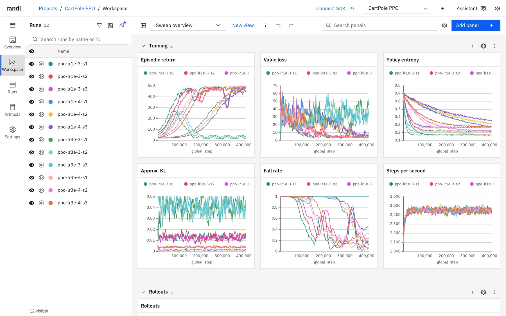
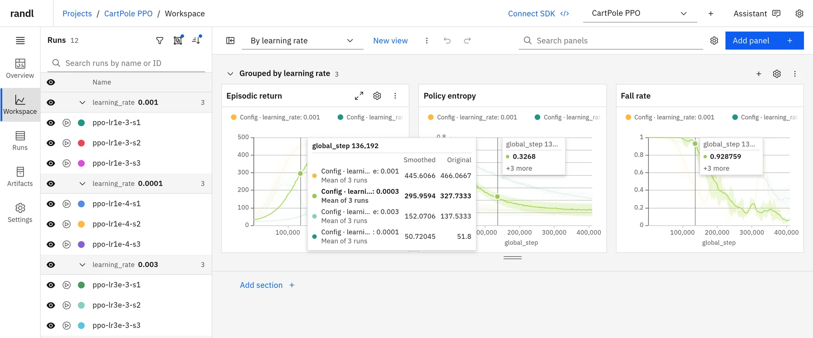
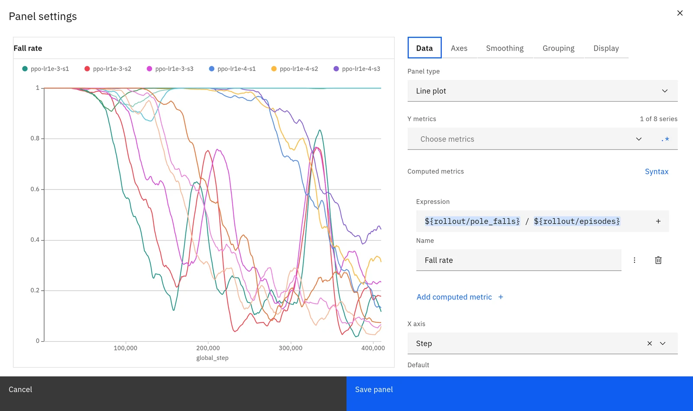
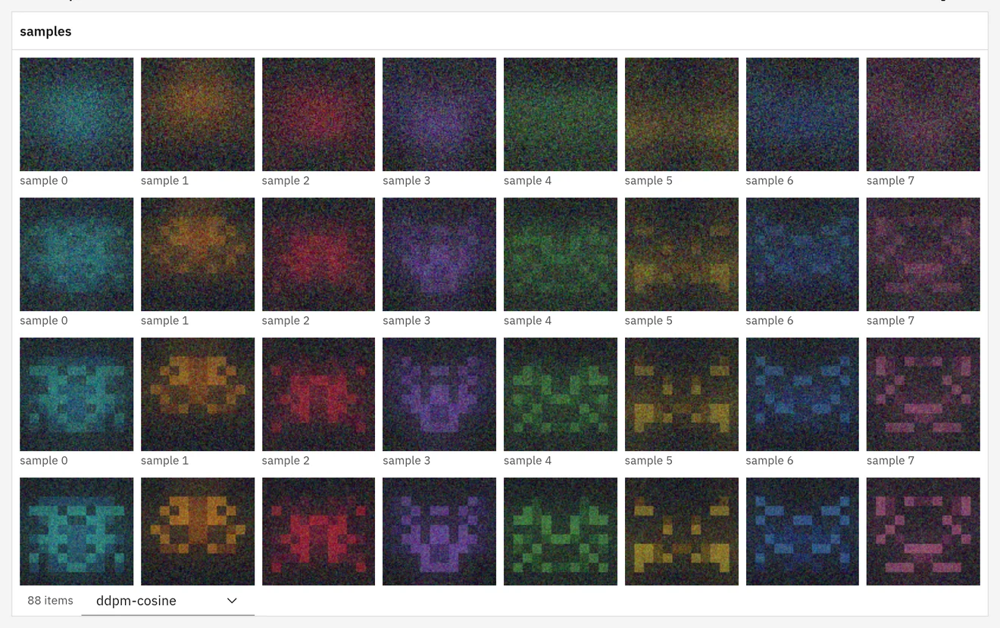
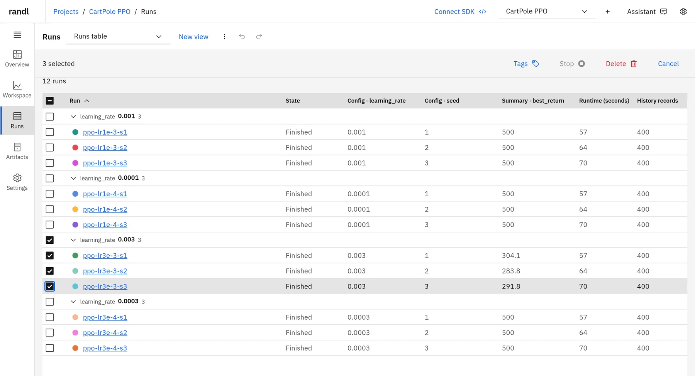

# Workspace and panels

A project's **Workspace** compares its runs in sections of panels that update as data arrives.
What you arrange there is saved in a **view**: the panels, which runs show, their colours,
filters and plot settings. This guide covers the dashboard; the same operations are tools for
scripts and agents (see [Scripting and agents](scripting.md)).

## Pages of a project

| Page          | Shows                                                                                     |
| ------------- | ----------------------------------------------------------------------------------------- |
| **Overview**  | Running runs with their live runtime, counts by state, compute time, storage, recent runs |
| **Workspace** | The run list beside sections of panels, saved as views                                    |
| **Runs**      | The runs table: search, filter, sort, group, choose columns, act on selected runs         |
| **Lineage**   | Runs as cards linked from the run each started from ([Lineage](lineage.md))               |
| **Findings**  | The project's findings ([Experiment ledger](ledger.md))                                   |
| **Plans**     | Recipe, GPU occupancy, the queue and ideas ([Planning](planning.md))                      |
| **Artifacts** | Artifact collections, versions, aliases, files and usage                                  |
| **Settings**  | Name and description, Connect SDK, media limit, deleted runs, deleting the project        |

A run's own page has tabs for its overview (with its journal and the findings that cite it),
metrics, config, summary, logs, files and artifacts. The **Server** page charts requests, response times,
transfer, errors, memory and database size for the last hour.

## Choosing runs



The run list beside the panels decides which runs the charts compare:

- **Show or hide** a run with its eye, or drag across several. Runs created after you last
  changed visibility show until you hide them.
- **Solo** one or more runs to compare only those; solos override visibility without changing
  it. Clear the solos to return.
- **Pin** up to 20 runs to the top of the list, and give any run its own colour.
- **Filter** by state, tags, config or summary values; group the list by any run field.

The table, the list and the charts can be grouped independently.

## Panels

Each section holds panels; drag the corner of a section to resize its panels and rows. Built-in
panel types are line, area, stacked area, percent area, bar, scatter, history scatter, parallel
coordinates, histogram, table, image, audio and video. Installed [custom panels](custom-panels.md)
appear beside them.

- **Hover** to read values. The cursor and the hovered run are linked across every panel and
  the run list.
- **Zoom** by dragging across a chart; only the points it lacks are fetched.
- **Export** a panel as PNG or its data as CSV from the panel menu.
- **Full screen** opens a panel on its own, with the same settings.

Panels are created for every logged metric (the view's **automatic** generation) unless you
switch the view to **manual**. Hide metrics by name or pattern.

## Plot settings



Settings apply at three levels: the whole workspace, a section and a panel. The nearest level
that sets a value wins, and the editor marks where each value comes from.

| Setting            | Choices                                                                                                     |
| ------------------ | ----------------------------------------------------------------------------------------------------------- |
| X axis             | `_step`, wall time, relative time, runtime, or any logged metric such as `update` or `epoch`                |
| Smoothing          | None, EMA, time-weighted EMA, Gaussian, centered running average; original traces drawn faintly beneath     |
| Scales and ranges  | Linear or log; fixed minimum and maximum; **Exclude outliers from the Y range** with percentile bounds      |
| Grouping           | Group by any config value, tag or run field; mean, median, min or max with a spread band                    |
| Resolution         | Low, Medium, High or no downsampling; see [Performance](performance.md)                                     |
| Layout             | **Single** chart, **Grid** (one small chart per run or group, shared axes) or **Coverflow** (one at a time) |
| Legend and tooltip | Position, template, how many runs the tooltip lists, full or coloured names                                 |
| Runs per panel     | All compared runs, a limit, or only the focused run                                                         |

The full list of fields is [Plot settings](../reference/tools.md#plot-settings) in the tool
reference.

## Computed metrics



A line panel can plot a formula over metrics logged in the same history record:

```text
${rollout/collisions} / ${rollout/episodes}
```

Formulas support numbers, `+ - * / % **`, comparisons, `&& || !`, `?:` and `Math` functions,
with completion of metric names. randl parses them itself; no JavaScript runs. They are
evaluated per record, before grouping and smoothing.

## Media



Image, video and audio panels show logged files as tiles: all runs at one step, or one run
across its steps. A slider shared by the section steps through the logged media by step, time or
any metric. Video autoplays muted while on screen (both can be turned off) and streams with
seeking. Enter on a tile opens it full screen.

Each run keeps at most 500 MiB of media by default. Over the limit, media are thinned evenly
over steps, keeping the first and the newest of each key; the limit is set in **App settings →
Storage** and per project in **Settings → Media limit** ([Deployment](deployment.md#data-and-limits)).

## Runs table



Search, filter, sort and group runs; choose up to 32 columns from config, summary and run
fields; select runs to tag, stop, show in Lineage or delete. Deleted runs stay in the
project's **Settings → Deleted runs** until restored or the project is deleted.

## Views

A view saves everything above for one project. Views have undo and redo, and two editors
cannot overwrite each other: a save names the version it started from, and a save over a newer
version is refused so the dashboard can reload and reapply. The view list in the workspace
header creates, renames, duplicates and deletes views.

## Keyboard and touch

- With a chart focused, the arrow keys move the inspected point; Escape clears it.
- On the Findings page, `/` focuses the search.
- On phones and tablets, press and hold a chart, then drag, to zoom. The layout collapses to
  one column below 760 px.

## The same operations as tools

| Task                        | Tool                                                                                                                                                       |
| --------------------------- | ---------------------------------------------------------------------------------------------------------------------------------------------------------- |
| Create, read, rename a view | [`view_create`](../reference/tools.md#view_create), [`view_get`](../reference/tools.md#view_get), [`view_rename`](../reference/tools.md#view_rename)       |
| Add, change, remove a panel | [`panel_add`](../reference/tools.md#panel_add), [`panel_update`](../reference/tools.md#panel_update), [`panel_remove`](../reference/tools.md#panel_remove) |
| Show and solo runs          | [`runs_select`](../reference/tools.md#runs_select)                                                                                                         |
| Save a whole view           | [`view_save`](../reference/tools.md#view_save)                                                                                                             |
| Tag, stop, delete runs      | [`runs_update`](../reference/tools.md#runs_update)                                                                                                         |

For example, a view with one smoothed return chart and two soloed runs:

```sh
VIEW=$(randl views create --project team/navigation --name "Width study" | jq -r .id)
randl panels add --view "$VIEW" --metric eval/return
randl select --view "$VIEW" --solo team/navigation/wide02,team/navigation/lr03
```
